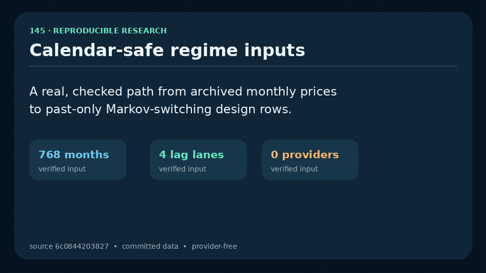

# 145

## Original research reproduction

```bash
# Run from the repository root with R installed.
Rscript install_dependencies.R
Rscript run_research.R
```

The runner executes `145finalproject.R` with committed original data; pass an archived R filename as the first argument to select another script. Exploratory intermediate sections remain research artifacts. The original full exploratory script remains separate from the checked core lanes below; complete-script outputs and forecasting performance are unverified. No replacement observations or estimators are supplied.

## Checked Markov fitting lanes

```bash
Rscript -e 'install.packages(c("xts","MSwM","dplyr","knitr","urca"), repos="https://cloud.r-project.org")'
Rscript test_temporal.R
Rscript run_regime_core.R
Rscript run_regime_core.R --past-only
```

The archived lane executes the original selected data transforms and MS regression formulas, with serial MSwM initialization; it skips Plotly presentation and stops before later exploratory sections. The separate past-only lane derives chronological predictors from earlier observations and drops leading missing rows; it is a new re-estimation, not reproduction of the archived coefficients or award results. Both lanes export model objects, AIC with sample counts, transition matrices and probability PNGs. Do not compare AIC across different sample sizes. `RESEARCH_MAX_ITER` optionally bounds EM iterations; the original default remains 100. Successful execution does not establish global optimizer convergence or predictive calibration.

The past-only lane now validates that adjacent input rows are consecutive calendar months before assigning month-lag labels. A missing month fails with an explicit date-gap error instead of silently treating the previous available row as a one-month predictor. Its `alignment-summary.csv` records the exact target and predictor spans for lags 1–4.



The GIF and companion MP4 are generated from the committed study window and verified against an actual R alignment receipt in CI. `scripts/verify_demo.py` also pins every runtime input to the recorded source commit and fully decodes the media. The visualization is an educational input-integrity receipt, not evidence of forecasting, trading, or investment performance.

**Temporal input finding:** the archived `realpricelag` column corresponds to the next month's price, not the previous month. On finite comparable rows, every observation matches the future price within 0.01; only three match the past price. Archived fits are retrospective only. Smoothed regime probabilities also condition on later observations. Neither fitting lane demonstrates trading or forecast performance: chronological held-out evaluation is still required. The corrected input CSVs expose dates and past predictor dates for inspection.
